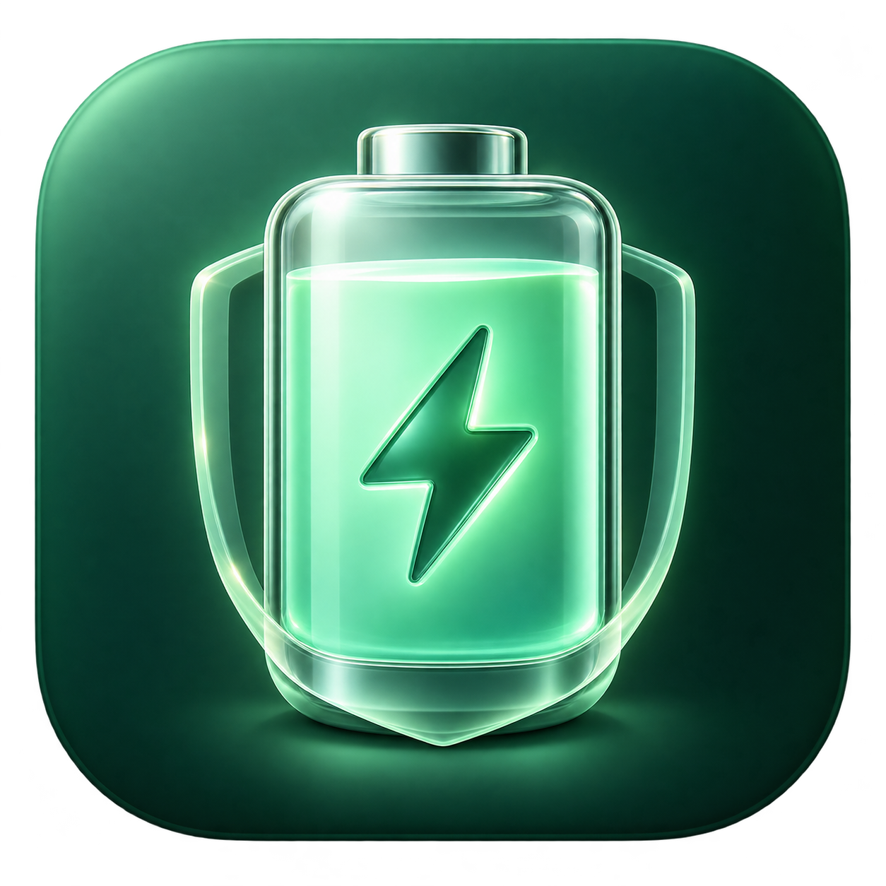
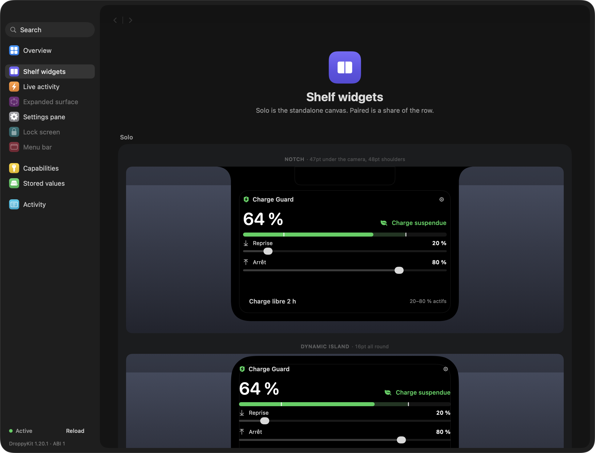
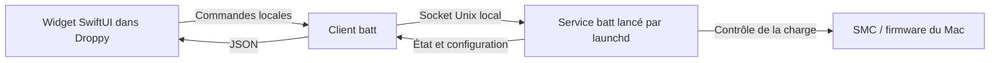

  

<h1 align="center">Charge Guard</h1>

Réglez la charge de votre MacBook directement depuis la notch.

  <a href="https://github.com/Nicolasdellim/chargeguard-droplet/releases/latest">Télécharger</a> ·
  <a href="#installation">Installation</a> ·
  <a href="docs/ARCHITECTURE.md">Architecture</a> ·
  <a href="CONTRIBUTING.md">Contribuer</a>

**Charge Guard est un dropplet natif pour [Droppy](https://getdroppy.app)** qui permet de choisir quand votre MacBook peut commencer et arrêter de charger. Sa plage par défaut est **20–80 %**, et les deux seuils sont modifiables depuis la notch.

L’interface est écrite en SwiftUI. Le contrôle réel de la batterie est assuré par [batt](https://github.com/charlie0129/batt), un moteur open source installé comme service système après votre autorisation administrateur. AlDente n’est pas nécessaire.

> Version communautaire distribuée comme dropplet local. Ce projet n’est ni un produit officiel Droppy, ni affilié à AlDente ou à Apple.

## Pourquoi ce projet ?

L’idée est de retrouver les réglages essentiels d’un limiteur de charge, comme ceux qui ont motivé l’utilisation d’AlDente, dans un endroit déjà accessible sur le Mac : la notch.

Quand le Mac reste souvent branché, on peut préférer un plafond personnalisé à une batterie maintenue à 100 %. Charge Guard permet de définir ce plafond, de choisir le niveau de reprise et de voir l’état courant sans ouvrir une application dédiée. Il n’annonce aucun gain chiffré de durée de vie de la batterie.

Le projet se concentre sur cette fonction : **une interface courte dans Droppy, deux seuils et un moteur indépendant qui continue à travailler en arrière-plan**.

## Ce que vous pouvez faire

- Régler **Reprise** et **Arrêt** directement dans la notch.
- Cliquer sur **Appliquer**, ou annuler les modifications en attente.
- Utiliser le préréglage **20–80 %**.
- Lire le niveau de batterie, l’état de charge et la plage actuellement appliquée.
- Autoriser une **charge libre pendant 2 h**, avec restauration automatique de la limite par le service.
- Afficher le pourcentage près de la notch avec l’activité compacte optionnelle.
- Installer, réparer et désinstaller le moteur depuis les réglages du dropplet.

La notch reste ouverte pendant le glissement d’un curseur. Les curseurs gardent au moins deux points d’écart entre les seuils. Les valeurs sélectionnées sont distinctes des valeurs confirmées par le moteur.

  

*Capture du harness DroppyKit avec des données de démonstration. Le niveau de 64 % ne correspond pas à une mesure sur votre Mac.*

## Comment les seuils fonctionnent

Avec une plage de **20–80 %** :

| Situation | Comportement |
| --- | --- |
| Batterie à 20 % ou moins, chargeur branché | Le moteur autorise la recharge en mode legacy. |
| Batterie en train de charger entre les seuils | Elle continue à charger jusqu’au plafond. |
| Batterie à 80 % ou plus | La charge est suspendue. |
| Batterie entre les seuils après une suspension | La charge reste suspendue jusqu’au seuil de reprise. |
| Chargeur débranché | Le Mac fonctionne normalement sur batterie. |

Ce comportement est une **hystérésis** : l’état précédent est conservé entre les deux seuils, ce qui évite de basculer à chaque variation de 1 % autour du plafond.

**Suspendre la charge ne force pas la décharge.** Le chargeur peut continuer à alimenter le Mac. Une machine branchée à 80 % ne descendra donc pas nécessairement rapidement vers 20 %.

Sur le backend legacy de batt, la comparaison de reprise est strictement « inférieur à ». Charge Guard traduit donc une reprise utilisateur à 20 % en borne interne **21 %**, pour autoriser la charge dès que le niveau entier atteint 20 %. En mode firmware, il transmet le seuil inférieur directement à batt ; les décisions sont alors prises par le firmware.

## Compatibilité

| Élément | État |
| --- | --- |
| Matériel visé | MacBook avec Apple Silicon et contrôle compatible avec batt v0.8.0 |
| Matériel vérifié | MacBook Air M4, backend legacy |
| Intel | Non pris en charge par le moteur inclus |
| Hôte | Droppy 15.3.0 minimum, ou Droppy Playground pour le développement |
| Cible macOS du code | macOS 14 ou ultérieur, avec un hôte compatible |
| Langue de l’interface | Français |
| Développement | Swift 6.2 minimum pour le package, outils Xcode et DroppyKit 1.20.1 |

Le bundle Swift est universel, mais **le moteur embarqué est arm64**. Cela n’ajoute pas de compatibilité Intel. Les autres générations Apple Silicon et toutes les versions de firmware n’ont pas été vérifiées. Le dropplet affiche l’incompatibilité signalée par batt lorsqu’elle est détectée.

## Installation

1. Installez une version compatible de **Droppy**.
2. Téléchargez `ChargeGuard-1.1.0.droplet.zip` depuis les [releases](https://github.com/Nicolasdellim/chargeguard-droplet/releases/latest), puis décompressez-le.
3. Dans Droppy, ouvrez **Réglages → Droplet Store → Local droplets**, puis importez `Chargeguard.droplet`. Acceptez l’exécution du build local si Droppy le demande. Le nom exact des boutons dépend de la langue de l’hôte.
4. Dans les réglages de **Charge Guard**, cliquez sur **Installer / réparer** et autorisez l’installation avec le mot de passe administrateur macOS.
5. Choisissez vos seuils, puis cliquez sur **Appliquer**. Le moteur démarre initialement en charge libre ; les seuils ne deviennent actifs qu’après cette étape.
6. Ajoutez **Charge Guard** aux widgets de la shelf de Droppy, puis ouvrez la notch pour retrouver les deux curseurs.

Le build public est signé localement, sans certificat Developer ID ni notarisation Apple. Les autorisations de macOS et de Droppy restent applicables. Si votre configuration refuse ce build local, vous pouvez le [compiler depuis les sources](CONTRIBUTING.md) ; le projet n’installe aucun contournement global de Gatekeeper.

### Utilisation quotidienne

Déplacez **Reprise** ou **Arrêt**, puis cliquez sur **Appliquer** dans la notch. Le bouton de retour annule les modifications non appliquées. Les valeurs de reprise acceptées vont de 11 à 97 %, celles d’arrêt de 13 à 99 %, avec au moins deux points d’écart.

**Charge libre 2 h** autorise la recharge normale, jusqu’à 100 %, pendant deux heures. Le moteur restaure ensuite les seuils, même si Droppy est fermé. Il s’agit d’une pause chronométrée, pas d’un mode qui s’arrête automatiquement dès l’arrivée à 100 %. **Reprendre** réapplique immédiatement les seuils sélectionnés.

L’engrenage ouvre les réglages avancés : installation du moteur, préréglage, activité compacte et désinstallation.

## Comment cela fonctionne techniquement

- Le dropplet tourne dans le processus de Droppy et expose un widget, des réglages et une activité compacte.
- Il lit l’état du moteur toutes les **15 secondes**, et le relit après une action. Cet intervalle concerne l’affichage ; le moteur gère sa propre boucle de contrôle.
- Les commandes de batterie s’exécutent hors de l’acteur principal, pour préserver la réactivité de l’interface.
- Le service système tourne avec les privilèges nécessaires au contrôle du SMC. Le mot de passe est demandé par macOS ; il n’est pas transmis à Charge Guard.
- Les seuils appliqués sont relus avant d’être considérés comme confirmés.
- Fermer Droppy ou désactiver uniquement le widget laisse le service et ses limites actifs.

Consultez [l’architecture détaillée](docs/ARCHITECTURE.md) pour le protocole, les emplacements installés et le cycle de vie.

## Limites connues

- Un cycle physique complet de décharge puis de recharge n’a pas été effectué lors de la validation initiale.
- En mode legacy, le moteur est configuré pour suspendre la charge avant la veille et réévaluer l’état au réveil. La recharge pendant la veille n’est donc pas garantie.
- Le service ne tourne pas après extinction complète de macOS.
- Les mécanismes et restrictions de contrôle de charge varient selon le firmware. Une mise à jour système peut modifier la compatibilité.
- La protection thermique, la calibration automatique, la décharge forcée et la gestion de la LED MagSafe ne sont pas exposées par Charge Guard.
- Ne faites pas fonctionner plusieurs contrôleurs de charge simultanément. L’installateur refuse les services batt standard et les assistants AlDente connus qu’il recherche ; cette détection n’est pas exhaustive.
- Le service accepte les commandes des clients locaux via son socket Unix. Il n’expose pas de serveur distant ; les autres processus locaux capables d’accéder à ce socket peuvent modifier ses paramètres de batterie.

## Désinstallation

Dans les réglages de Charge Guard, cliquez sur **Désinstaller le moteur** et autorisez l’opération. Le script rétablit d’abord la charge normale, puis retire le service système et son exécutable. Vous pouvez ensuite retirer le dropplet de Droppy.

**Supprimer uniquement le dropplet ne supprime pas le moteur.** Le fichier de configuration et les journaux sont conservés dans `/Library/Application Support/ChargeGuard` après désinstallation.

Si le service est en panne, la désinstallation s’arrête lorsqu’elle ne peut pas confirmer le rétablissement de la charge. [Ouvrez une issue](https://github.com/Nicolasdellim/chargeguard-droplet/issues) en décrivant le problème et les messages visibles.

## Vérification

La version initiale a été vérifiée avec :

- Cinq tests automatisés : validation des plages, hystérésis à 20/80, lecture du protocole JSON, rejet des données incomplètes et échappement des chemins d’installation.
- Compilation universelle et validation locale DroppyKit.
- Rendu des trois surfaces déclarées avec un rapport sans problème.
- Chargement effectif dans Droppy Playground puis Droppy.
- Installation du moteur sur un MacBook Air M4 ; lecture des bornes 80/21 et de la permission de charge désactivée au-dessus du plafond.
- Pause temporaire suivie d’une restauration automatique des seuils par le service.

La validation matérielle ci-dessus a été réalisée **sur batterie, chargeur débranché** ; elle confirme les paramètres et l’état retourné par le moteur, pas un cycle physique complet de recharge.

## Sources, licences et crédits

Le code de ce dépôt est distribué sous **GPL-2.0-only** ; voir [LICENSE](LICENSE).

- **[Droppy / DroppyKit](https://getdroppy.app/docs/droppykit)** fournit l’hôte, les surfaces et le SDK. Droppy est un produit distinct et n’est pas redistribué ici. Les conditions de ses composants restent applicables.
- **[batt v0.8.0](https://github.com/charlie0129/batt/tree/v0.8.0)**, par Charlie et ses contributeurs, fournit le contrôle matériel. Le binaire arm64, sa licence et l’archive du code source correspondant sont inclus dans `Assets/Engine/`. Voir [THIRD_PARTY_NOTICES.md](THIRD_PARTY_NOTICES.md).
- L’icône personnalisée a été créée avec l’outil intégré **imagegen**. Le [prompt de création](docs/icon-prompt.txt) est fourni. Cette icône est utilisée pour la distribution locale ; une éventuelle publication dans le Store officiel Droppy devra suivre ses règles propres.

Les contributions et retours de compatibilité sont bienvenus : [contribuer](CONTRIBUTING.md) ou [signaler un problème](https://github.com/Nicolasdellim/chargeguard-droplet/issues).
